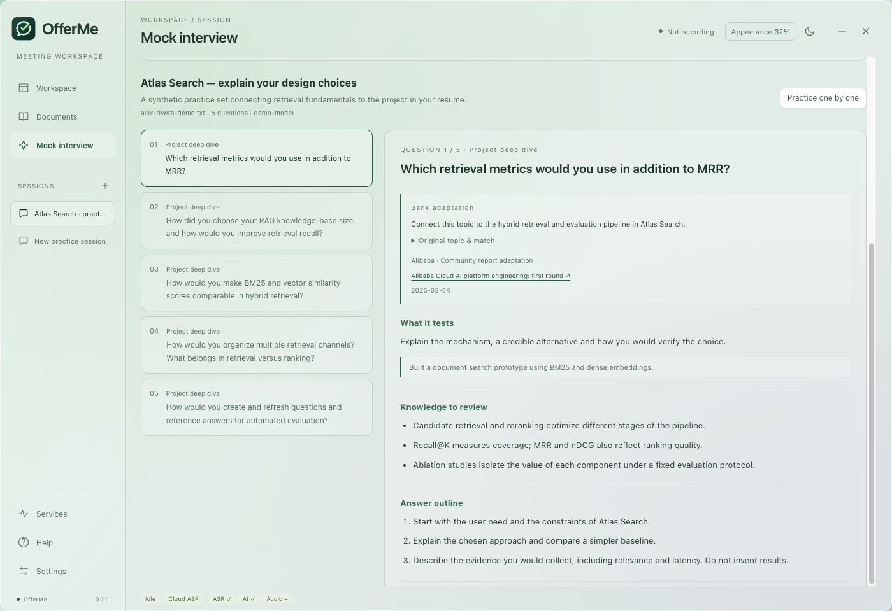

# OfferMe

**把你的经历，准备成有依据的回答。**

OfferMe 是一个支持中英文的桌面面试练习与会议辅助工具。导入简历、JD、项目和论文资料，从公开来源题库中检索相关考点，再通过你配置的云端 API 生成练习题、知识点、追问和回答反馈。



- 210 条考点、39 个来源，覆盖 9 类算法与机器学习方向。
- PDF、DOCX、TXT、Markdown 本地解析，支持项目／论文多文件、预览与选择。
- 实时云端转写，回答 API、语音 API、视觉 API 分别配置。
- 透明界面、深浅主题、预设与自定义背景色。
- 会话和练习历史本地保存；不下载本地模型。

新用户默认英文，可在设置中切换中文。详细的英文图文介绍和配置过程见 [README](README.md)、[完整配置指南](docs/GUIDE.en.md) 和 [Mac 音频配置](docs/MACOS_AUDIO.md)。

```bash
git clone https://github.com/Xiao-0309/OfferMe.git
cd OfferMe
npm ci
npm run dev
```

需要 Node.js 22.12+（22.x）、macOS 13+ 或 Windows 10+；macOS 还需要 Xcode Command Line Tools。仅练习面试可通过高级设置只配置回答 API；实时转写还需语音 API 和音频路由。

macOS 使用耳机时，需要“耳机 + BlackHole 2ch”双输出。会议扬声器选系统默认／双输出，OfferMe 对方音频输入选 BlackHole。只选耳机不能让 BlackHole 收音，只选 BlackHole 则自己听不到。

新版本使用独立 `OfferMe` 配置目录，不自动读取其他应用的密钥或会话。密钥优先使用系统加密；会话和提取文字以普通 JSON 保存。启用的参考材料会随相关请求和背景预热发送至所配服务商。OCR、文档向量检索和联网搜索不在当前功能内。

OfferMe 独立维护，采用 [Apache-2.0](LICENSE)。继承代码的原作者声明和修改记录保留在 [NOTICE](NOTICE) 与 [UPSTREAM.md](UPSTREAM.md)。
