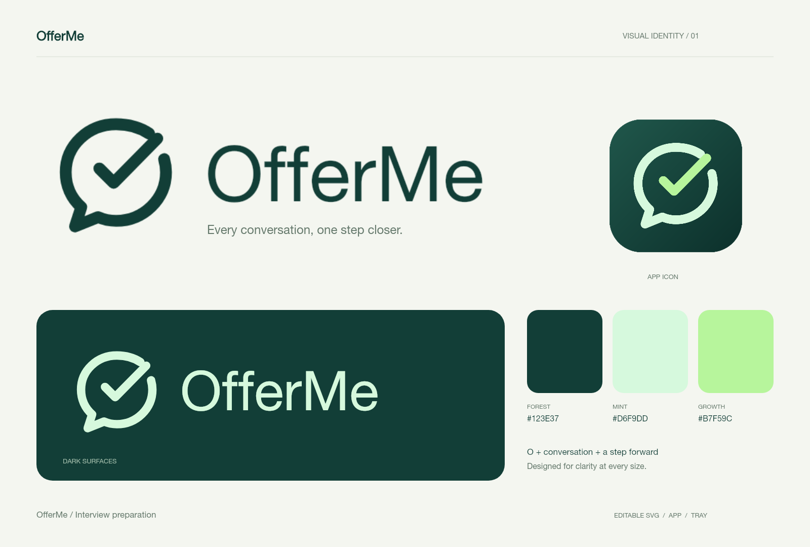

# OfferMe visual identity

OfferMe combines an open **O**, a conversation bubble and an upward check. The open corner makes the check part of the silhouette rather than a badge placed over it. The symbol represents preparation, dialogue and progress.

- `mark.svg`: editable 1024 x 1024 application icon with transparent outer corners.
- `logomark.svg` / `logomark-light.svg`: transparent standalone symbol for light/dark backgrounds.
- `lockup.svg` / `lockup-light.svg`: horizontal symbol and OfferMe wordmark, with an editable Helvetica/Arial/system sans-serif text layer.
- `symbol.svg`: single-color macOS menu-bar master; its tighter view box preserves clarity at 22 px.
- `exports/`: transparent PNG lockups, application icon and presentation sheet.
- `npm run build:brand`: regenerates renderer SVG, PNG, ICO, ICNS, tray icons and preview exports without network access.

| Color | Hex | Use |
| --- | --- | --- |
| Forest | `#123E37` | Primary mark and wordmark |
| Mint | `#D6F9DD` | Reversed mark on dark backgrounds |
| Growth | `#B7F59C` | Check accent on the application icon |

Keep at least one stroke-width of clear space around the symbol. Use the monochrome master in the macOS menu bar. Keep the wordmark in one line and preserve the capital O and M in **OfferMe**. Small sizes use only the symbol, without the wordmark. Do not fade text with whole-window opacity; the app uses independently translucent surfaces.

The identity is maintained as part of OfferMe. Version 0.7 uses the independent bundle ID `io.github.xiao0309.offerme` and the `OfferMe` profile directory. Source provenance and required notices are recorded in [UPSTREAM.md](../UPSTREAM.md) and [NOTICE](../NOTICE).
