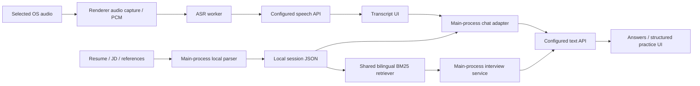

# Architecture

OfferMe is an Electron + React + TypeScript desktop application. Cloud services perform speech recognition and model inference. Document extraction, topic retrieval, UI state and session persistence happen locally.

## Process boundaries

`electron/main.ts` owns the app lifecycle, IPC handlers, provider calls, native dialogs, settings and window visibility. `electron/preload.ts` exposes a narrow `window.offerme` interface; setup has its own `window.offermeSetup` bridge. Renderers use context isolation and do not receive stored plaintext keys.

`src/` renders the conversation workspace, practice studio, provider setup and diagnostics. The audio capture path labels the other speaker and optional local microphone separately. Windows loopback and macOS virtual-input capture have different device paths.

`electron/asr/` contains the streaming task-protocol adapter and the per-segment audio-chat adapter. It does not contain a local inference engine or model downloader.

`native/macos/audio-route.swift` creates/checks/restores an explicit two-output route. Automatic restoration requires saved route state and a packaged, non-isolated launch. It never selects a meeting application's speaker on the user's behalf.

## Domain modules

| Module | Responsibility |
| --- | --- |
| `shared/protocol.ts` | Typed settings, events and IPC contracts |
| `electron/settings.ts` | Default/merged settings, encrypted key slots, migration and public projection |
| `electron/docparse.ts` | Local text extraction from supported files |
| `shared/documents.ts` | Enabled full-text reference context and deduplication |
| `shared/interviewBank.ts` | Source registry, bilingual search and deterministic ranked retrieval |
| `electron/llm/interview.ts` | Practice prompts, source-ID validation, structured output and cancellation |
| `electron/llm/adapter.ts` | Chat Completions HTTP/SSE adapter |
| `shared/docsLinks.ts` | Exact bundled-document allowlist and canonical project links |

## Retrieval and context

Interview retrieval uses a small in-memory lexical index with Chinese bigrams, English terms, aliases and BM25-style scoring. Track/company preferences and per-session seen IDs affect selection. Source diversity is favored. The English overlay preserves the original corpus and stable IDs.

Document attachments use full extracted-text context. There is no embedding service, vector database, browser search tool or OCR pipeline. Keep this distinction explicit in documentation: **topic retrieval** selects sourced practice questions; **document context** supplies enabled materials to the API.

## Identity and persistence

The application is named `OfferMe`, bundle ID `io.github.xiao0309.offerme`, and uses an `OfferMe` application-data directory. `OFFERME_USERDATA` selects an isolated test/development profile. No other app's private profile is imported automatically. Native route state belongs to this identity too.

Session text is not encrypted. Imported originals stay on disk; parsed text lives with each session. API keys use OS encryption when available and an explicitly flagged weaker fallback otherwise. See [security](../SECURITY.md).

## Verification

Unit tests cover retrieval, JSON validation, settings, document import, audio state, lifecycle and provider errors. Mock HTTP/WebSocket integration tests exercise request shapes without paid services. A hidden-window Electron harness covers the rendered English workflow and saves synthetic screenshots. These checks do not replace actual hardware, Bluetooth, signing or live-provider testing.
