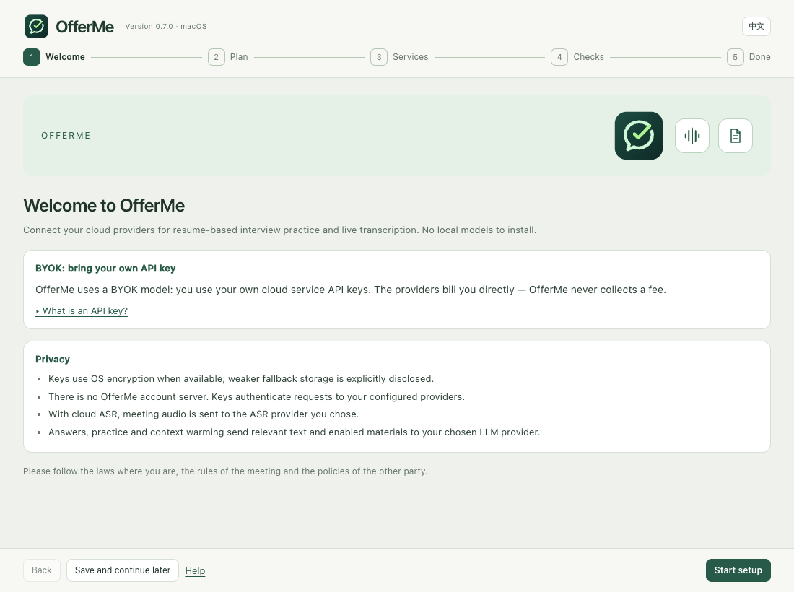
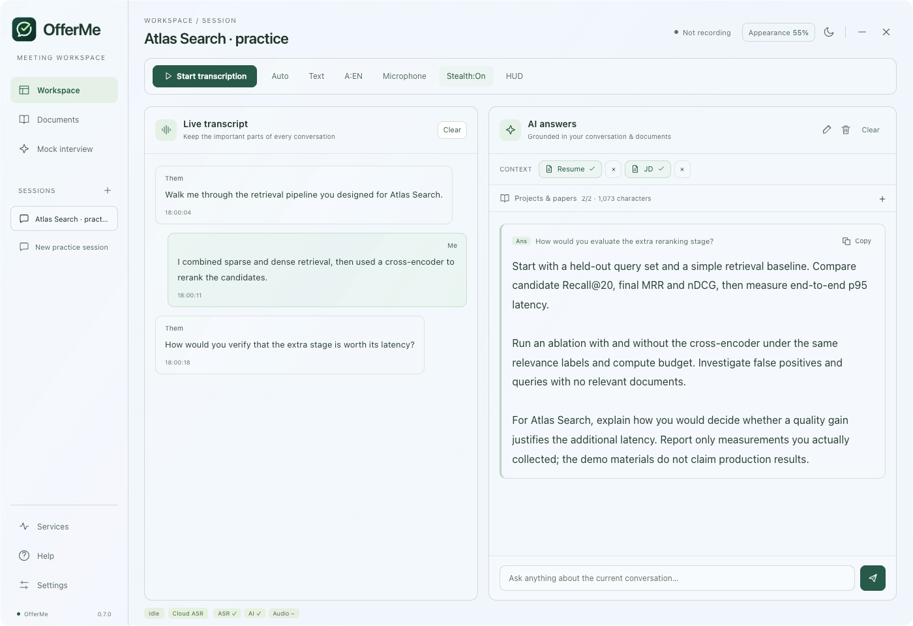
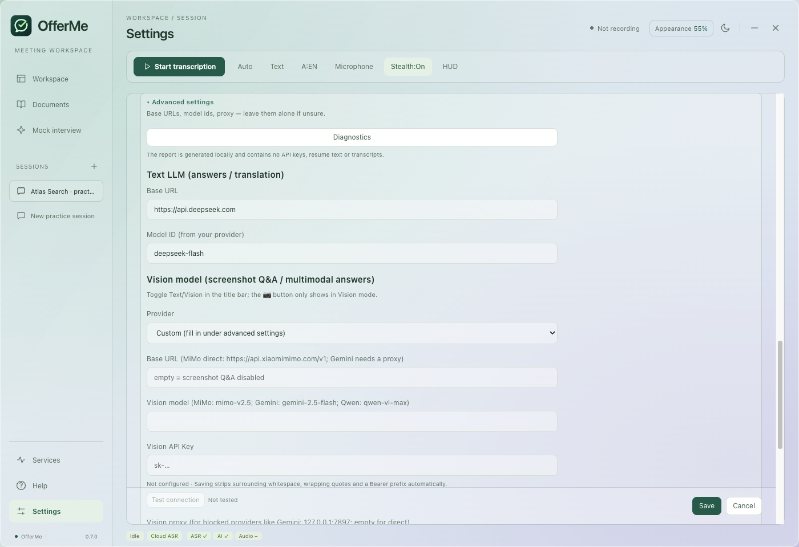
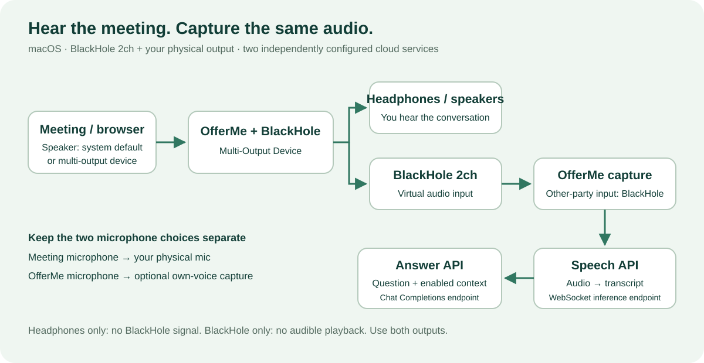
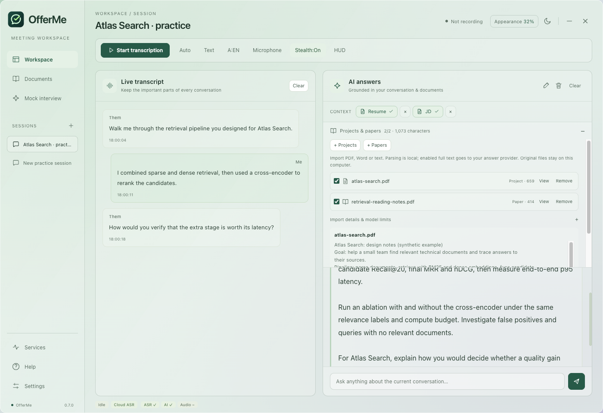
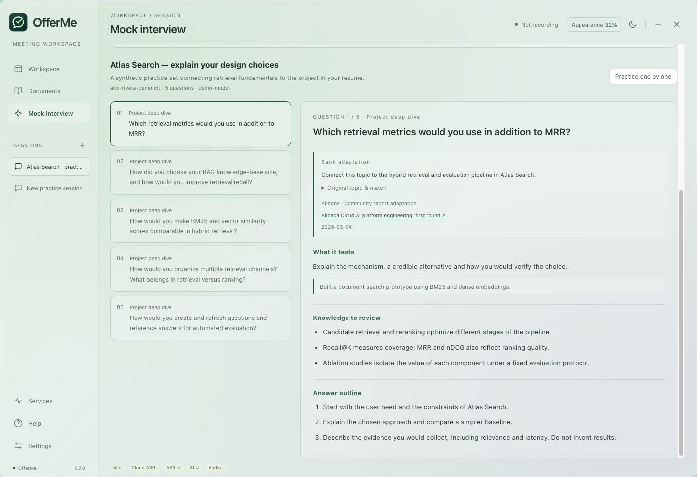

# OfferMe setup and user guide

[Back to the project](../README.md) · [macOS audio](MACOS_AUDIO.md) · [Interview bank](INTERVIEW_BANK.md)

This guide covers the cloud API edition of OfferMe 0.7. You configure your own providers; OfferMe does not install speech or language models locally. Provider access, model availability and billing belong to your provider account.

## 1. Install the development version

Requirements:

- Node.js **22.12+ (22.x)**, npm and Git.
- macOS **13+** with Xcode Command Line Tools, or Windows **10+** with Node.js installed. The macOS minimum follows the bundled [Electron runtime](https://www.electronjs.org/docs/latest/breaking-changes).
- An internet connection for installing dependencies and making cloud API requests.
- A text-generation API key for answers and practice. A separate speech-capable key is required for transcription. Vision is optional.

On macOS, run `xcode-select --install` once if developer tools are missing. Then:

```bash
git clone https://github.com/Xiao-0309/OfferMe.git
cd OfferMe
npm ci
npm run dev
```

`npm ci` uses the checked-in lockfile. The Electron runtime is downloaded as a development dependency; this is not a model download. Keep the terminal running while using development mode. Stop it with Ctrl+C.

## 2. First launch and language



The wizard covers a plan, provider credentials, connection checks and completion. You can save progress and return later. English is the default; use the language control to choose Chinese, or change **Settings → Appearance → UI language** later. Answer language is a separate setting.

For interview practice without meeting audio, use **Custom API setup** to reach the main workspace, configure only text answers, and open **Mock interview**. You do not need microphone access, BlackHole or a speech key to practice from a resume.

Each API key is saved in its own slot. Leaving an existing key field blank preserves it; use the explicit remove control to delete it. The interface displays only a short hint for saved keys.

## 3. Configure text answers



Open **Settings** to select a provider and save its key. Expand **Advanced settings → Text LLM** to edit the base URL and model (or use the provider card in the wizard):

1. Select a preset, or choose a custom Chat Completions-compatible provider.
2. Enter the **base URL**, **model ID** and **API key** from the same service.
3. Set answer language to English, Chinese or the available automatic option.
4. Save and run the text connection test. A successful speech test does not prove the answer provider works.



OfferMe appends `/chat/completions` to the base URL. For example, `https://provider.example/v1` becomes `https://provider.example/v1/chat/completions`. Do not enter the full completions URL, a console URL or an API-key management page. Use HTTPS for remote services.

A current DeepSeek example is base URL `https://api.deepseek.com`, model `deepseek-flash`, and a key created in the DeepSeek platform. Existing user-selected models are not overwritten. Provider model names change; check the [official API guide](https://api-docs.deepseek.com/) when a model is unavailable. Reasoning models can take longer before returning visible answer text.

A custom gateway must implement the Chat Completions protocol, including SSE streaming for live answers. An endpoint that only implements a different response protocol is not automatically compatible. OfferMe does not manage the gateway's upstream accounts.

## 4. Configure streaming speech recognition

In **Settings → Transcription (ASR)** choose **Cloud streaming**. The supported adapter uses Alibaba Cloud's task-based WebSocket inference protocol, including Fun-ASR-Realtime and Paraformer. It does not support arbitrary WebSocket services or every model containing “realtime” in its name.

| Setting | Example |
| --- | --- |
| WebSocket URL, Beijing workspace | `wss://YOUR_WORKSPACE_ID.cn-beijing.maas.aliyuncs.com/api-ws/v1/inference` |
| Model | `fun-asr-realtime` or a supported `paraformer-realtime-v2` deployment |
| API key | A key authorized for that region and workspace |
| Language hint | Auto-detect initially; choose English or Chinese if supported by your model |

Replace `YOUR_WORKSPACE_ID` with the workspace ID shown in your provider console. The default public Beijing endpoint is `wss://dashscope.aliyuncs.com/api-ws/v1/inference`; workspace-specific credentials may require the dedicated domain. A chat base URL ending `/compatible-mode/v1` is not the streaming endpoint. Check Alibaba's [Fun-ASR WebSocket guide](https://help.aliyun.com/en/model-studio/fun-asr-realtime-websocket-api) and [protocol overview](https://help.aliyun.com/en/model-studio/realtime-websocket-overview) for your region.

Enable the service and model access in the provider console, then save and run the ASR connection test. The built-in provider test sends a bundled sample, not live meeting audio. It verifies credentials and the speech service. The next section verifies your actual audio route; both must work.

**Alternative: cloud per-segment ASR.** This adapter sends a WAV `input_audio` message to a chat endpoint, such as a compatible MiMo ASR model. It is not a generic Whisper `/audio/transcriptions` multipart client. A text-only chat model will not transcribe audio. Provider-specific presets remain subject to the provider's current availability; test the exact configuration.

## 5. Connect meeting audio

### macOS

Follow the [illustrated BlackHole and AirPods guide](MACOS_AUDIO.md). The essential routing is:



- Meeting/browser output: a multi-output device combining your physical headphones/speakers and BlackHole 2ch.
- OfferMe other-party input: BlackHole 2ch.
- Meeting microphone: your physical microphone, **not** BlackHole.
- OfferMe's own microphone capture: optional; leave off if only the other speaker is needed.

macOS may require microphone permission for virtual audio inputs, and screen-capture permission for screenshot features. Grant only the permissions needed by the features you use. Development Electron and a packaged OfferMe build have different application identities; permissions may be requested separately. Replacing unsigned builds can also trigger another permission request.

### Windows

The meeting-audio path uses Electron system loopback. Play the meeting on the intended Windows output, start capture in OfferMe, and complete any system sharing/permission prompt. The optional microphone captures your own voice separately. Windows audio behavior needs validation on your own hardware; do not assume a successful provider test proves loopback capture.

### Verify the whole chain

1. Run the ASR provider test first.
2. Play a short, non-private spoken sample **on this computer**. Speaking from a phone only tests the microphone if microphone capture is enabled.
3. Start capture. Confirm the audio indicator detects sound and transcript text appears.
4. Ask about a transcript segment. Confirm the configured answer API returns text.
5. Stop capture before changing outputs or disconnecting headphones.

The app captures the selected OS audio path; it does not log in to Tencent Meeting, Feishu, DingTalk or your browser. A meeting's explicit speaker setting can bypass the system route even while you hear it normally.

## 6. Add a resume, JD, projects and papers

Create a session. Use **Resume** and **JD** for the two dedicated slots. Open **Projects & papers** to add multiple supporting documents.



Supported formats: PDF with a text layer, DOCX, TXT, MD and Markdown. Files are parsed locally. Inspect the preview and character count before relying on extracted text. Assign each reference as a project or paper, and enable only the materials needed for this session. Removing a reference does not delete the original file.

Enabled extracted text is kept in full and included in the relevant answer/practice context. This is full-context attachment support, not embedding-based document retrieval. Long documents can exceed the model's context window or increase cost. Deselect unnecessary references or use shorter, relevant documents when the provider reports a context-limit error.

Scanned PDFs need an external OCR step. Complex equations, tables and multicolumn layouts may extract imperfectly. Importing a paper does not mean its findings are your own work; prompts distinguish reference material from claimed personal contributions.

## 7. Prepare and rehearse an interview



1. Open **Mock interview** and import a readable resume.
2. Optionally add a JD and enabled project/paper references.
3. Choose a direction, company preference, target role, difficulty, question count (5/8/12) and output language.
4. Expand **Interview bank & retrieval** to inspect the next candidates or search the bank.
5. Generate a set. OfferMe retrieves local topics first, then asks your text provider to adapt them to your materials.
6. Review source citations, knowledge points, an answer outline and follow-ups.
7. Start practice, write your answer, request feedback, and reveal notes when ready.

**Prefer unseen topics** is enabled by default. Successful generation records topic IDs in this session; failed or cancelled attempts do not consume them. When the eligible pool runs low, the app explicitly includes review topics. Company preference can be supplemented with other companies when coverage is insufficient, with each source retained.

A generation failure keeps the previous plan. Changing the resume, JD or enabled references marks the plan stale; regenerate before requesting feedback on the new material. Source ID validation rejects invented links, but it does not prove every statement in an AI answer is correct.

## 8. Appearance and window controls

Use **Appearance** in the title bar for six palettes, a custom color and transparency from 0–75%. Light, dark and system themes are available. The surface transparency is independent of text opacity. Settings are saved locally.

Minimized/hidden windows can be restored from the Dock/taskbar or tray menu. Closing to the tray and quitting the process are different actions; choose **Quit** in the tray menu to exit completely. Shortcuts can be configured in Settings. Capture protection is best-effort and does not guarantee exclusion from screen sharing.

## 9. Optional screenshot questions

Configure the vision provider separately, using a Chat Completions endpoint that accepts image inputs. Switch to vision mode, choose a screenshot region, and ask a question. The selected image is sent to that provider. A text-only model or a speech-model key will not satisfy this capability.

## Data storage and costs

| Data | Storage / destination |
| --- | --- |
| Settings and encrypted key slots | OS application-data directory named `OfferMe` |
| Transcripts, answers, resumes, extracted references, practice | Local session JSON, not encrypted by OfferMe |
| Active audio | Configured ASR provider while capture is active |
| Questions and enabled material context | Configured answer provider; also used by answer-mode context warming and conversation memo updates |
| Screenshot questions | Configured vision/answer provider, depending on your selected mode |
| Provider tests | Small text/sample-audio/image requests to the service being tested |

On macOS the profile is `~/Library/Application Support/OfferMe`; on Windows it is `%APPDATA%/OfferMe`. API keys use Electron's OS-backed encryption when available. A flagged base64 fallback is obfuscation, not encryption. A key encrypted on one machine/profile should be re-entered on another instead of copying encrypted settings blindly.

OfferMe 0.7 does not automatically read another application's profile or migrate earlier design-preview credentials. Configure the new profile explicitly. The original project and its data can coexist.

Interview generation and feedback use the text answer provider. Background warming is used by the conversation workspace and can send enabled material context before a visible answer; entering practice mode avoids immediate practice-related prewarming. Provider usage limits and charges still apply. Check balance, usage, rate limits and data retention in the provider console; OfferMe does not infer remaining credit from your key.

## Troubleshooting

| Symptom | Check |
| --- | --- |
| `401` / invalid key | Confirm the key belongs to the endpoint and capability, remove accidental whitespace and retest that slot. |
| `403` / access denied | Check account/model authorization, workspace, region and the provider's access policy. A successful network connection is not proof of model access. |
| Service not purchased / enabled | Enable the selected speech model in the correct regional provider console. |
| `404` / model unavailable | Check current model ID and whether the base URL accidentally contains `/chat/completions` twice. |
| `429` / quota exceeded | Check balance, rate limits and concurrency in the provider console. |
| `502`, `503`, timeout | Test the provider independently. For a self-hosted gateway, inspect its upstream health and logs. |
| ASR test succeeds, meeting has no words | Verify audio routing, selected input, actual audio level, and the meeting's speaker override. See the macOS guide. |
| Headphones silent but transcription works | Output is probably BlackHole alone; use the multi-output device. |
| You can hear the meeting, but BlackHole is silent | The meeting or browser may output directly to headphones; select system default/multi-output. |
| PDF has no text | It may be scanned, protected or malformed. OCR/export it to a readable text format first. |
| Too few interview matches | Broaden direction/company filters, add relevant material or reduce the question count. |
| Invalid structured interview response | Retry with fewer questions or a model that follows JSON instructions. The previous plan is retained. |
| Nothing appears when restoring | Try the tray's show command; report OS, app version and reproduction steps if it persists. |

Use **Help → Diagnostics** for a redacted report. Review it before sharing; do not upload the complete profile, provider credentials or private documents.

## Build a desktop package

```bash
npm run verify
npm run dist:dir
```

For distributable archives, run `npm run dist:mac` on macOS (Apple Silicon ZIP) or `npm run dist:win` on Windows (x64 installer and portable executable). Output is under `release/`. Run the packaged app without keeping a development terminal open.

The source project does not include developer signing credentials, Apple notarization or a Windows code-signing certificate. macOS/Windows may show a trust prompt for locally built packages. Build from reviewed source and use your operating system's application-specific approval flow; do not disable system security globally.

For a separate development profile, set `OFFERME_USERDATA` to a temporary directory before starting the app. This also suppresses automatic managed audio-route restoration. Do not point a test build at your everyday profile.

## Developer checks and screenshots

```bash
npm run check:public
npm run typecheck
npm test
npm run build
npm run test:ui
npm run screenshots
```

The UI script uses a hidden Electron window, a temporary profile and a loopback-only mock provider. It neither records your desktop/audio nor calls a paid API. Screenshots contain explicitly synthetic materials. Real microphone routing, Bluetooth reconnection, signing and external provider availability require separate device/account tests.
