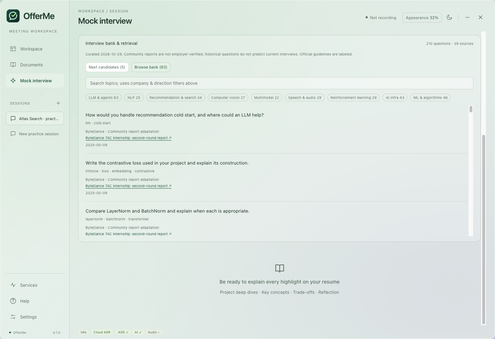

# Interview bank and retrieval

OfferMe bundles **210 paraphrased topics from 39 public sources**, curated on 2026-10-29. The corpus is a versioned local snapshot. It does not scrape the web during practice, predict current company questions or cover every role equally.

## Coverage

Topics can belong to multiple directions; the rows do not sum to the number of unique topics.

| Direction | Topics |
| --- | ---: |
| LLMs & agents | 63 |
| NLP | 25 |
| Recommendation / search / ads | 34 |
| Computer vision | 27 |
| Multimodal & generative models | 22 |
| Speech & audio | 29 |
| Reinforcement learning | 29 |
| AI infrastructure | 43 |
| ML & algorithms | 46 |

## From material to a practice question

1. Extract keywords from the resume, JD, target role and enabled references.
2. Match Chinese bigrams, English terms and bilingual aliases against topic text, English translations, tags and tracks.
3. Rank using BM25-style lexical relevance, direction/company preferences and source diversity.
4. Prefer eligible unseen topic IDs when the session's option is enabled. Disclose review items or company supplementation.
5. Send the selected topics and enabled material context to the configured answer API for adaptation.
6. Accept only structured responses with one valid, unique bank ID per selected topic. At most one third may be labeled extensions; source links come from the local registry, never a model-supplied URL.

The UI shows original topic, source type, source link, reported date and material connection. Direction-only matches are labeled as foundation exercises. If too few topics match, generation stops before calling the provider and asks for broader filters, more material or fewer questions.

Successful generation adds IDs to the session's seen history. Cancellation/failure preserves the old plan and history. Relevance remains a constraint: avoiding repeats does not justify filling a set with unrelated topics. Different IDs may still overlap in concepts.

## Provenance and limits

Most sources are public Nowcoder community reports. They are self-reported and not employer-verified. Amazon and Microsoft official preparation guides describe capabilities; topics derived from them are labeled **official guide exercises**, not quoted interview questions.

The public registry omits author usernames and retains role, URL, reported date, check date and access method. `access: search-index` identifies material available only through a public search index during curation. A month/day without a confirmed year remains explicitly undated; no year is inferred. Some older reports remain useful for fundamentals without implying current hiring practice.

Sources and original topic paraphrases live in `resources/interview-bank/seed.json`. English topic/source labels live in `resources/interview-bank/en.json`, keyed by stable IDs. Author usernames are omitted; public source URLs are retained for attribution. English and Chinese searches use the same corpus and identity mapping.

There is no claim of completeness, employer affiliation or guaranteed interview success. AI adaptation and feedback can be mistaken even when a source ID is valid. Verify technical claims and explain your actual contributions rather than inventing metrics or experience.

## Contributing topics

- Supply a publicly accessible original URL and accurate date/access metadata; do not include personal usernames.
- Summarize one specific topic in your own words. Do not copy full reports, answers, paywalled courses or private interview material.
- Use a unique stable topic/source ID, declared track/category and accurate company attribution. Use the multiple-company category when a source does not assign each topic reliably.
- Add an English translation for every new topic and a translated title/date label for a new source. Omit author nicknames, contact details and other personal identifiers from both languages; keep company attribution and the public source URL.
- Check overlap with existing topics and add meaningful retrieval tests when extending a concept or direction.
- Update the corpus version/check date only when justified; run `npm run verify` and inspect the browser UI.

For a correction or attribution/removal request, open a GitHub issue identifying the source/topic ID. Do not include private interview transcripts.
