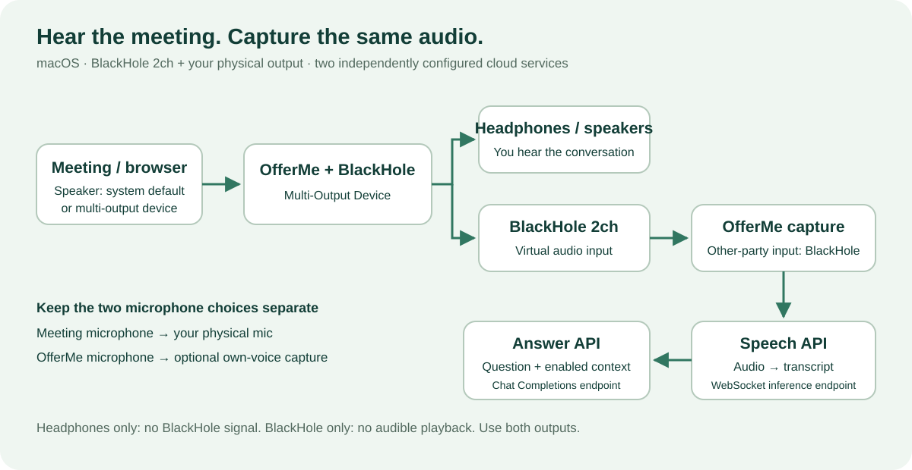

# macOS meeting audio: BlackHole + headphones

[Setup guide](GUIDE.en.md) · [Project](../README.md)

A microphone test and a cloud speech test do not verify meeting-audio capture. OfferMe must receive the same output that you hear from the meeting. Use a **Multi-Output Device** to send sound to both your physical output and BlackHole 2ch.



## Install BlackHole 2ch

Use the [official BlackHole installer](https://existential.audio/blackhole/) or Homebrew:

```bash
brew install blackhole-2ch
```

Complete the installer and restart macOS if requested or if the device does not appear. OfferMe does not bundle or install this driver automatically.

## Option A: configure from the source project

1. Connect your AirPods/headphones first.
2. Select them as the Mac's ordinary sound output. Confirm you can hear audio.
3. In the OfferMe source directory, run:

```bash
npm run audio:setup
npm run audio:status
```

The helper creates **OfferMe + BlackHole**, combining the currently selected physical output with BlackHole 2ch, selects it as the output and records the previous device. It will not configure a route from BlackHole alone. If the current output is an incomplete aggregate device, select the physical output first and retry.

A packaged OfferMe launch checks/reapplies a route previously configured through this helper. It does not silently create a first-time route. Headphones must still be connected; a device switch or a meeting-specific speaker override may need attention. Source development sessions do not automatically restore managed routes.

To restore the saved physical output:

```bash
npm run audio:restore
```

The previous device must be connected. Restoring removes the saved managed-route state; it does not uninstall BlackHole.

## Option B: configure in Audio MIDI Setup

1. Open **Audio MIDI Setup → Window → Show Audio Devices**.
2. Click **+ → Create Multi-Output Device** (not an input-only aggregate).
3. Enable your physical headphones/speakers and **BlackHole 2ch**.
4. Use the physical two-channel output as the primary/clock device. Enable drift correction for the other device where available.
5. Name it **OfferMe + BlackHole** and select it as the Mac's sound output.

These steps follow BlackHole's [official multi-output guide](https://github.com/ExistentialAudio/BlackHole/wiki/Multi-Output-Device). Manually created devices are not registered with OfferMe's managed-route helper simply because their display name matches; you maintain that route in Audio MIDI Setup.

## Configure the meeting and OfferMe

| Place | Select |
| --- | --- |
| macOS sound output | OfferMe + BlackHole (multi-output) |
| Meeting/browser speaker | System default, or the multi-output device explicitly |
| Meeting microphone | Physical microphone or headset microphone |
| OfferMe other-party audio input | BlackHole 2ch |
| OfferMe own microphone | Optional physical microphone; disable if unnecessary |

In Feishu, DingTalk, Tencent Meeting or a browser meeting, recheck the **speaker** setting after connecting Bluetooth devices. A fixed AirPods output bypasses BlackHole. Refreshing a browser meeting or reselecting its speaker may be necessary after a route change.

## Test without a real meeting

Play a short spoken sample on the Mac, start capture in OfferMe and verify all three:

- You can hear it through the intended headphones/speakers.
- OfferMe's audio indicator detects a signal.
- Transcript text appears.

If the ASR service test passes but the signal stays silent, investigate the device path before changing the API key. If there is signal but no transcript, inspect the ASR status, language/model support and provider error.

## AirPods and common problems

- **Sound but no text:** a meeting/browser is outputting directly to AirPods, or OfferMe has the wrong input.
- **Text but no sound:** the Mac output is BlackHole alone, or the physical member is disconnected.
- **Works before reconnecting:** Bluetooth changes can invalidate the saved device combination. Stop capture, reconnect, select the physical output, rerun `audio:setup`, then restart capture.
- **Poor quality when using the AirPods microphone:** try the Mac's built-in microphone while keeping AirPods for output; Bluetooth input/output modes can differ.
- **Volume keys stop working:** macOS multi-output volume is adjusted per physical device. See the BlackHole guide.
- **Permission prompts return:** development Electron, repackaged unsigned apps and installed OfferMe are distinct identities to macOS. Use one stable installed build when possible. No app can promise that macOS will never ask again.

The helper configures only audio routing. It does not alter meeting settings, grant OS permissions or verify that a remote participant is speaking.
